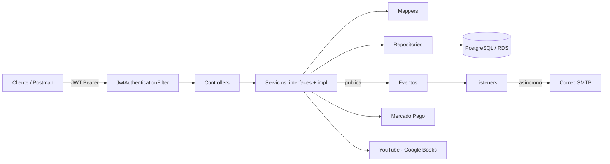
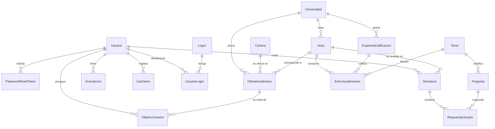

# RumboU — Plataforma de preparación para el examen de admisión (UNI y UNMSM)

- **Curso:** CS 2031 Desarrollo Basado en Plataforma — UTEC, 2026-2 (Proyecto 1, Semana 7, y Proyecto 2, Semana 14)
- **Integrantes:** Marco Emilio Bautista Ortega, Fabiana Gomez, Juan Carlos Alexander Vergara Montalván y Zoe Camila Garrido Cantoni
- **API en producción (AWS):** https://184-194-122-22.sslip.io ([health](https://184-194-122-22.sslip.io/api/v1/health))
- **Web y app móvil:** [`rumbou-frontend`](https://github.com/marcobautista-sketch/rumbou-frontend), publicada en https://rumbou-frontend.vercel.app
- **Colección de Postman:** [`postman_collection.json`](postman_collection.json) · **Guía de uso detallada:** [`GUIA-DE-USO.md`](GUIA-DE-USO.md)

## Índice

1. [Introducción](#1-introducción)
2. [Identificación del problema o necesidad](#2-identificación-del-problema-o-necesidad)
3. [Descripción de la solución](#3-descripción-de-la-solución)
4. [Modelo de entidades](#4-modelo-de-entidades)
5. [Manejo de errores](#5-manejo-de-errores)
6. [Medidas de seguridad implementadas](#6-medidas-de-seguridad-implementadas)
7. [Eventos y asincronía](#7-eventos-y-asincronía)
8. [GitHub y gestión del proyecto](#8-github-y-gestión-del-proyecto)
9. [Conclusión](#9-conclusión)
10. [Apéndices](#10-apéndices)

## 1. Introducción

### Contexto

En el Perú, el ingreso a la UNI y la UNMSM se decide en un examen muy competitivo. Cada universidad y área tiene su estructura de prueba, su penalidad y un puntaje de corte por carrera que cambia en cada proceso. RumboU es una API REST en Spring Boot para prepararse con esas reglas exactas (UNI área General; UNMSM áreas B y C). La web y la app móvil están en `rumbou-frontend`; la API también se prueba completa con Postman.

### Objetivos

- Rendir simulacros que repliquen el examen real: mismas preguntas por tema, mismo acierto y penalidad.
- Traducir el puntaje en avance: Puntaje Simulado Proyectado (PSP) e Índice de Progreso (IP) frente al último ingresante de la carrera objetivo.
- Mantener un banco de preguntas que un revisor aprueba antes de publicarlo.
- Incentivar la constancia con racha, XP, logros y una liga semanal, y sostener el servicio con un modelo freemium.

## 2. Identificación del problema o necesidad

### Descripción del problema

Los postulantes practican con material genérico que no refleja la calificación de su universidad: una misma pregunta vale y penaliza distinto en la UNI y en la UNMSM. Tampoco saben qué tan cerca están de ingresar, porque eso depende del puntaje del último ingresante, que cambia cada proceso.

### Justificación

Una preparación de calidad suele estar limitada a quien paga una academia. Modelar las reglas de cada examen como datos permite llegar a más personas y agregar universidades sin cambiar la arquitectura.

## 3. Descripción de la solución

### Funcionalidades implementadas

- **Autenticación y roles:** registro, login, JWT con refresh token, recuperación de contraseña y tres roles: `USER`, `REVIEWER` (aprueba preguntas) y `ADMIN`.
- **Simulacros:** `COMPLETO`, `DIAGNOSTICO` y `POR_TEMA`; califican con la penalidad real, calculan el PSP y muestran la corrección.
- **Progreso:** carreras objetivo con PSP, IP y semáforo; dominio por tema e historial de PSP (PRO).
- **Banco de preguntas:** 792 preguntas aprobadas, filtros paginados y aprobación de un revisor antes de publicarse.
- **Catálogo académico:** 51 carreras y 70 ofertas con sus reglas de examen, cargadas desde CSV.
- **Suscripción PRO:** Mercado Pago, webhook firmado e idempotente, límites centralizados en `PlanService` y vencimiento diario.
- **Gamificación:** racha, XP semanal que vuelve a 0 cada lunes, logros y una liga semanal voluntaria con alias.
- **Desafío diario**, **plan de estudio** con videos de YouTube y libros de Google Books, y **correos** HTML con Thymeleaf.

### Tecnologías utilizadas

Java 21, Spring Boot 3.3.5, Maven · Spring Data JPA, Hibernate, PostgreSQL 16 · Spring Security, JWT (jjwt), BCrypt · YouTube Data API, Google Books, Mercado Pago, JavaMailSender + Thymeleaf · JUnit 5, Mockito, MockMvc, Testcontainers · GitHub Actions, Docker, AWS (EC2 + RDS), Postman.

### Arquitectura

Cada controller solo delega en una interfaz de servicio (`service/`), implementada en `service/impl/`. Los servicios obtienen al usuario del `SecurityContext` con `CurrentUserService`, convierten entidades a DTOs con `mapper/` y nunca exponen entidades.

### Decisiones de diseño

- **Reglas como datos:** `CalificadorService` recibe el esquema como parámetro; no hay un condicional por universidad.
- **Acciones como subrecursos:** `POST /simulacros/{id}/finalizar` y `PATCH /preguntas/{id}/aprobar` son transiciones con reglas (calificar, publicar eventos), no simples cambios de campo.
- **Sin HATEOAS:** el cliente conoce sus rutas y cada respuesta trae los ids que encadenan el flujo.
- **Interfaces solo donde hay contrato:** las tienen los servicios que usan controllers y listeners, no los auxiliares internos.

## 4. Modelo de entidades

### Diagrama

### Descripción

19 entidades JPA con `id` heredado de `BaseEntity`. Todas las relaciones `@ManyToOne` son `LAZY`; `Simulacro → RespuestaUsuario` y `Usuario → UsuarioLogro / PasswordResetToken` son `@OneToMany` con `cascade` y `orphanRemoval`, porque esos hijos no existen sin su padre. Hay índices en las columnas más consultadas y `@UniqueConstraint` donde el negocio lo exige.

| Grupo | Entidades | Qué representan |
| --- | --- | --- |
| Autenticación | `Usuario`, `PasswordResetToken` | Cuenta con rol, racha, XP y alias opcional para la liga; token de reseteo de un solo uso |
| Académico | `Universidad`, `Area`, `Carrera`, `OfertaAcademica`, `EsquemaCalificacion`, `Tema`, `EstructuraExamen` | Reglas del examen como datos: preguntas por tema, acierto, penalidad y corte |
| Contenido | `Pregunta` | Pertenece a un tema, no a una universidad: el banco sirve para ambas |
| Examen | `Simulacro`, `RespuestaUsuario` | El intento y cada respuesta con su puntaje, que puede ser negativo |
| Progreso | `ObjetivoUsuario` | Carrera objetivo con el último PSP e IP |
| Suscripción | `Suscripcion`, `UsoDiario`, `PagoWebhook` | Plan, contadores del plan gratuito y pagos procesados (idempotencia) |
| Gamificación | `Logro`, `UsuarioLogro`, `DesafioDiario` | Logros, cuáles desbloqueó cada usuario y su desafío del día |

## 5. Manejo de errores

Un único `@RestControllerAdvice` responde siempre con `ErrorResponse` (`timestamp`, `status`, `error`, `message`, `path`). Las excepciones propias heredan de `ApiException`, que lleva su código HTTP:

- `ResourceNotFoundException` (404); `DuplicateResourceException` y `ResourceInUseException` (409).
- `InvalidCredentialsException`, `InvalidTokenException`, `InvalidWebhookSignatureException` (401).
- `ForbiddenException` y `PlanLimitExceededException` (403); `InvalidOperationException` (400).
- `ExternalServiceException` (502), cuando falla un servicio externo como Mercado Pago.

También cubre las de Spring y del framework: validación (400), JSON mal formado (400), JWT inválido (401), `@PreAuthorize` (403), método no permitido (405), media type (415), integridad de datos y bloqueo optimista (409). El 500 registra el error en el log y responde un mensaje fijo. Manejarlas así da respuestas consistentes y nunca expone trazas ni SQL.

## 6. Medidas de seguridad implementadas

### Seguridad de datos

- **Contraseñas** con BCrypt y política de fortaleza (`@Pattern`: mayúscula, minúscula y número).
- **JWT stateless:** access de 15 minutos y refresh de 7 días, con `userId` y `role`, firmados con `JWT_SECRET`. El refresh token no sirve como Bearer.
- **Autorización:** `@PreAuthorize` por rol (`ADMIN` gestiona preguntas y roles; `REVIEWER` aprueba) y verificación de dueño en los servicios mediante el `SecurityContext`.
- **Webhook firmado:** con `MP_WEBHOOK_SECRET`, Mercado Pago debe firmar cada notificación (HMAC-SHA256).
- **Secretos** solo en variables de entorno.

### Prevención de vulnerabilidades

- **Inyección SQL:** toda consulta con datos del usuario es parametrizada (Spring Data JPA).
- **XSS:** la API devuelve JSON y valida toda entrada con Bean Validation.
- **CSRF:** la API es stateless y autentica con el header `Authorization`. La única cookie, la del refresh token de la web, es `HttpOnly`, `Secure` y `SameSite=Strict`, y solo viaja a `/api/v1/auth`.
- **CORS:** orígenes configurables con `CORS_ALLOWED_ORIGINS`.

## 7. Eventos y asincronía

| Evento | Lo publica | Lo escucha | Modo |
| --- | --- | --- | --- |
| `SimulacroFinalizadoEvent` | `SimulacroService` | `GamificacionListener`, `ProgresoListener` | Síncrono, misma transacción |
| `PagoAprobadoEvent` | `WebhookService` | `SuscripcionActivacionListener`, `PagoAprobadoCorreoListener` | `AFTER_COMMIT` (correo `@Async`) |
| `PasswordResetRequestedEvent` | `AuthService` | `RecuperacionContrasenaCorreoListener` | `@Async` + `AFTER_COMMIT` |
| `UsuarioRegistradoEvent` | `AuthService` | `RegistroConfirmacionListener` | `@Async` + `AFTER_COMMIT` |

Los eventos desacoplan los módulos: el simulacro no conoce la gamificación ni el correo. Lo que llama a un tercero (el servidor de correo) es asíncrono sobre un `ThreadPoolTaskExecutor` propio, para que la respuesta HTTP no espere a un servicio lento o caído. Lo que depende de datos recién guardados usa `AFTER_COMMIT`.

## 8. GitHub y gestión del proyecto

- **Flujo:** `main` protegida, una rama por funcionalidad y merge solo por pull request con el CI en verde.
- **GitHub Actions:** [`ci.yml`](.github/workflows/ci.yml) ejecuta `mvnw verify` en cada push y PR: 361 pruebas unitarias, de controller, de repositorio con Testcontainers y de humo.
- **Issues:** milestone "Entrega Semana 7", labels por módulo, tipo y proceso, y responsables asignados.
- **Reparto:** Marco (autenticación, examen, preguntas, liga, despliegue), Juan Carlos (catálogo, progreso), Zoe (suscripción, gamificación, correo) y Fabiana (contenido, banco de preguntas, revisión de rúbrica). El detalle está en la tabla de participación.

### Participación y coevaluación de los integrantes

| Integrante | Principales aportes | Participación |
| --- | --- | --- |
| Marco Emilio Bautista Ortega | Backend: autenticación con JWT y refresh tokens, motor de simulacros y calificación, banco de preguntas, liga semanal, despliegue en AWS (EC2, RDS, HTTPS) y su evidencia. Web y móvil: la mayor parte de las pantallas, el Cuaderno de errores con cámara y micrófono, los temas por universidad, la liga semanal, la publicación en Vercel y en EAS. Coordinación del equipo y documentación. | 100 % |
| Fabiana Marcela Gomez Chavez | Backend: banco de preguntas (CRUD, filtros paginados, búsqueda por texto, aprobación individual y en lote), construcción y carga del banco de 792 preguntas, revisión del proyecto contra la rúbrica, rol REVIEWER e interfaces de servicio. Web: componentes base (Card, Badge, Modal, Skeleton, Pagination, Breadcrumbs, Table), layout con Navbar y Sidebar, modo oscuro, banco de preguntas y revisión, formularios con React Hook Form y Zod, historial paginado. Móvil: rendir simulacros, historial paginado, pestañas e inicio. Despliegue del móvil con EAS y HTTPS de la API. | 100 % |
| Juan Carlos Alexander Vergara Montalván | Backend: catálogo académico (universidades, áreas, carreras, ofertas, esquemas de calificación y temas) y su carga desde CSV, módulo de progreso (objetivos, PSP, IP, semáforo, dominio por tema e historial), `ProgresoListener` y manejo de parámetros inválidos. Web: inicio con racha y meta, mis objetivos, logros, catálogo de carreras con búsqueda, filtros y detalle. | 100 % |
| Zoe Camila Garrido Cantoni | Backend: suscripción PRO con `PlanService` y límites por plan, webhook de Mercado Pago idempotente, activación y vencimiento diario de suscripciones, gamificación (racha, XP, logros y su catálogo) y correos HTML con Thymeleaf y sus listeners. | 100 % |

Coevaluación del equipo: cada integrante cumplió el 100 % de las responsabilidades que asumió.

## 9. Conclusión

### Logros

La API cubre el flujo completo del postulante: registrarse, elegir carrera, rendir un simulacro con las reglas reales, revisar la corrección, ver su PSP e IP y pasar a PRO. Tiene 792 preguntas revisadas, está desplegada en AWS y la usan una web y una app móvil.

### Aprendizajes clave

- Modelar las reglas como datos permitió soportar dos universidades sin condicionales.
- `AFTER_COMMIT` exige abrir una transacción nueva (`REQUIRES_NEW`) para escribir.
- Un CI en verde no garantiza que la aplicación arranque: la prueba de humo con `@SpringBootTest` cerró ese hueco.

### Trabajo futuro

- Dominio propio en lugar de `sslip.io` y CORS restringido al frontend.
- Más universidades como cambio de datos.

## 10. Apéndices

### A. Ejecución local

Requisitos: Java 21 o superior (con Java 17 no compila) y Docker Desktop abierto; sin Docker la API no arranca ("Unable to determine Dialect").

1. `docker compose up -d` levanta PostgreSQL (puerto 5433) y Mailpit, que muestra los correos en `http://localhost:8025`.
2. `./mvnw spring-boot:run`, o *Run* sobre `BackendApplication` en el IDE, carga los datos, crea la cuenta de evaluación `ADMIN` y deja la API en `http://localhost:8080`, adonde apunta la colección.
3. `./mvnw test` corre las pruebas.

A tener en cuenta:

- Deben estar libres los puertos 5433, 8080, 1025 y 8025.
- La primera ejecución tarda unos minutos mientras descarga dependencias.
- Para probar cada rol, la colección trae la carpeta "Cambiar de rol" (guía de uso, sección 2).
- En local, "Crear suscripción PRO" responde 502 porque la clave de Mercado Pago no está en el repositorio; su funcionamiento en AWS consta en [`docs/despliegue-aws`](docs/despliegue-aws).

Variables de entorno: `SPRING_DATASOURCE_*`, `JWT_SECRET`, `ADMIN_EMAIL`, `ADMIN_PASSWORD`, `YOUTUBE_API_KEY` (también la usa Google Books, o `GOOGLE_BOOKS_API_KEY`), `MP_ACCESS_TOKEN`, `MP_WEBHOOK_SECRET`, `MP_BACK_URL`, `MP_TEST_PAYER_EMAIL`, `CORS_ALLOWED_ORIGINS`, `APP_RESET_PASSWORD_URL`, `SHOW_SQL` y `MAIL_*`. Todas tienen valor de desarrollo.

### B. Despliegue

Una instancia **EC2** ejecuta el jar con systemd detrás de nginx, con HTTPS de Let's Encrypt; los datos viven en **RDS PostgreSQL 16**, cuyo security group solo acepta a la instancia. La configuración llega por variables de entorno. La evidencia está en [`docs/despliegue-aws`](docs/despliegue-aws).

### C. Endpoints

Rutas bajo `/api/v1`. 🔒 requiere token; 🛡️ `ADMIN` o `REVIEWER`; 👑 solo `ADMIN`.

| Recurso | Endpoints |
| --- | --- |
| Sistema | `GET /health` |
| Autenticación | `POST /auth/register`, `/login`, `/refresh`, `/logout`, `/forgot-password`, `/reset-password` |
| Usuarios | 🔒 `GET`, `PUT /usuarios/me`, `PATCH /usuarios/me/contrasena`, `GET /usuarios/me/gamificacion` · 👑 `GET /usuarios?email=`, `PATCH /usuarios/{id}/rol` |
| Catálogo | 🔒 `GET /ofertas-academicas`, `GET /areas`, `GET /areas/{id}/temas` |
| Simulacros | 🔒 `POST /simulacros`, `GET /simulacros`, `GET /simulacros/{id}`, `POST /simulacros/{id}/respuestas`, `POST /simulacros/{id}/finalizar` |
| Progreso | 🔒 `POST /objetivos`, `GET /objetivos`, `DELETE /objetivos/{id}`, `GET /progreso/dominio-temas`, `GET /progreso/historial` |
| Desafío diario | 🔒 `GET /desafios/hoy`, `POST /desafios/hoy/respuesta` |
| Liga semanal | 🔒 `GET /ranking` (paginado), `PUT /ranking/participacion`, `DELETE /ranking/participacion` |
| Plan de estudio | 🔒 `GET /temas/{id}/videos`, `GET /temas/{id}/libros` |
| Preguntas | 🔒 `GET /preguntas`, `GET /preguntas/{id}` · 🛡️ `GET /preguntas/{id}/completa`, `PATCH /preguntas/{id}/aprobar`, `PATCH /preguntas/aprobar-lote` · 👑 `POST`, `PUT`, `DELETE /preguntas` |
| Suscripciones | 🔒 `POST /suscripciones`, `GET /suscripciones/me` · `POST /webhooks/mercadopago` (público, firmado) |

La colección de Postman trae los 57 requests con descripción, tests y una respuesta de ejemplo real; apunta a la API local (la de AWS está en `baseUrlAws`) e incluye la cuenta de evaluación `evaluador@rumbou.app` (`ADMIN`). Cada request se explica en la [guía de uso](GUIA-DE-USO.md).

### D. Licencia

Proyecto académico del curso CS 2031 (UTEC). Todos los derechos reservados por sus autores; no se distribuye bajo una licencia de código abierto.

### E. Referencias

- Spring Boot, Security y Data JPA — [spring.io](https://spring.io/projects) · Testcontainers — [testcontainers.com](https://testcontainers.com)
- YouTube Data API — [developers.google.com/youtube](https://developers.google.com/youtube/v3) · Google Books — [developers.google.com/books](https://developers.google.com/books) · Mercado Pago — [mercadopago.com.pe/developers](https://www.mercadopago.com.pe/developers)
- Prospectos de admisión de la UNI y la UNMSM.
